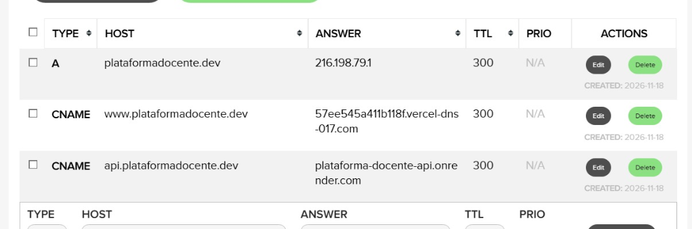
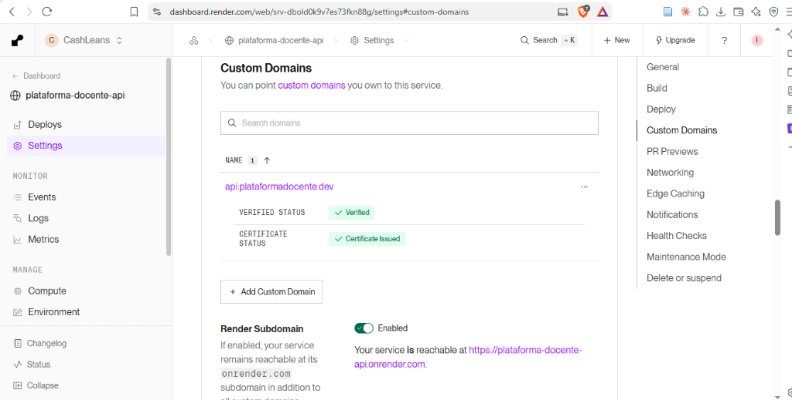
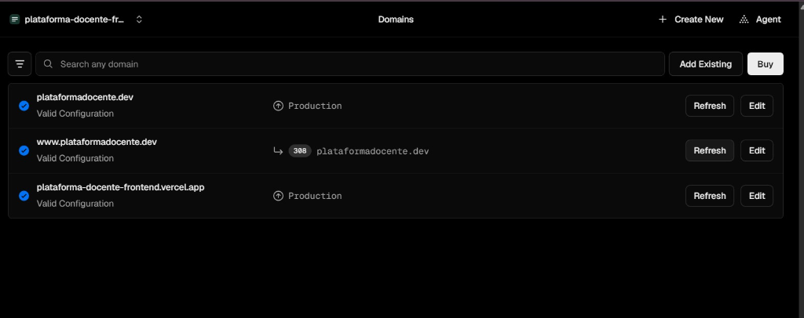
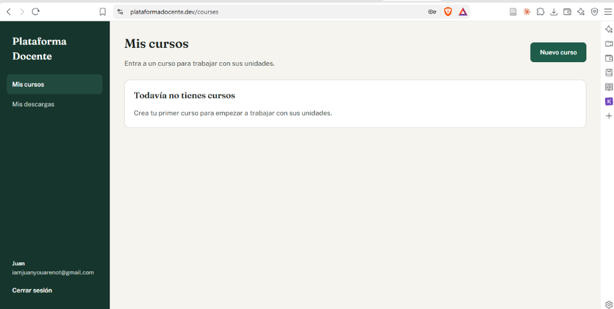

# Evidencia de Dominio Propio con HTTPS — QA-12

- **Tarea:** QA-12 (`specs/005-atributos-calidad/tasks.md`)
- **Tipo:** Infraestructura / Portabilidad y Seguridad (ISO/IEC 25010)
- **Dominio registrado:** `plataformadocente.dev`
- **Fecha y hora de comprobación:** 18 de noviembre de 2026, 22:23:49 GMT-05:00 (19 de noviembre de 2026, 03:23:49 UTC)
- **Responsables:** Juan (Backend, Render), Silvana (Frontend, Vercel) y Sergio (dominio en Name.com)

---

## 1. Configuración de Infraestructura

1. **Registro del Dominio:**
   - Adquirido en Name.com a través del GitHub Student Developer Pack por Sergio a nombre de un integrante del equipo.
   - Duración: 1 año, con renovación automática desactivada.

2. **Asignación de Entornos:**
   - **Frontend (Vercel):** `https://plataformadocente.dev` (producción) y `https://www.plataformadocente.dev` (redirección 308).
   - **Backend API (Render):** `https://api.plataformadocente.dev` (servicio `plataforma-docente-api.onrender.com`).

---

## 2. Comprobaciones Reales en Producción

### 2.1. Resolución DNS

#### `Resolve-DnsName plataformadocente.dev`
```text
Name                                           Type   TTL   Section    IPAddress                                
----                                           ----   ---   -------    ---------                                
plataformadocente.dev                          A      300   Answer     216.198.79.1                             
```

#### `Resolve-DnsName www.plataformadocente.dev`
```text
Name                           Type   TTL   Section    NameHost                                                        
----                           ----   ---   -------    --------                                                        
www.plataformadocente.dev      CNAME  300   Answer     57ee545a411b118f.vercel-dns-017.com                             

Name       : 57ee545a411b118f.vercel-dns-017.com
QueryType  : A
TTL        : 300
Section    : Answer
IP4Address : 216.198.79.65

Name       : 57ee545a411b118f.vercel-dns-017.com
QueryType  : A
TTL        : 300
Section    : Answer
IP4Address : 64.29.17.65
```

#### `Resolve-DnsName api.plataformadocente.dev`
```text
Name                           Type   TTL   Section    NameHost                                                        
----                           ----   ---   -------    --------                                                        
api.plataformadocente.dev      CNAME  282   Answer     plataforma-docente-api.onrender.com                             
plataforma-docente-api.onrende CNAME  282   Answer     gcp-us-west1-1.origin.onrender.com                              
r.com                                                                                                                  
gcp-us-west1-1.origin.onrender CNAME  282   Answer     gcp-us-west1-1.origin.onrender.com.cdn.cloudflare.net           
.com                                                                                                                   

Name       : gcp-us-west1-1.origin.onrender.com.cdn.cloudflare.net
QueryType  : A
TTL        : 287
Section    : Answer
IP4Address : 216.24.57.18

Name       : gcp-us-west1-1.origin.onrender.com.cdn.cloudflare.net
QueryType  : A
TTL        : 287
Section    : Answer
IP4Address : 216.24.57.16
```

---

### 2.2. Comprobaciones de Redirección y Certificados HTTPS

#### `curl.exe -sS -I https://plataforma-docente-frontend.vercel.app`
```http
HTTP/1.1 200 OK
Accept-Ranges: bytes
Access-Control-Allow-Origin: *
Age: 115
Cache-Control: public, max-age=0, must-revalidate
Content-Disposition: inline
Content-Length: 916
Content-Type: text/html; charset=utf-8
Date: Thu, 19 Nov 2026 03:24:22 GMT
Etag: "0eb376f4a6270cd5997dfcecc4a4da10"
Last-Modified: Thu, 19 Nov 2026 03:22:26 GMT
Server: Vercel
Strict-Transport-Security: max-age=63072000; includeSubDomains; preload
X-Vercel-Cache: HIT
X-Vercel-Id: gru1::dtnqg-1795058662141-7e151834017b
```
*(Nota: El dominio `.vercel.app` responde `200 OK` porque en el panel de Vercel está asignado como dominio de producción. Para completar la redirección, se debe configurar en Vercel una redirección 308 hacia `plataformadocente.dev`).*

#### `curl.exe -sS -I http://api.plataformadocente.dev/health`
```http
HTTP/1.1 301 Moved Permanently
Date: Thu, 19 Nov 2026 03:22:54 GMT
Content-Type: text/html; charset=utf-8
Connection: keep-alive
Location: https://api.plataformadocente.dev/health
cf-cache-status: DYNAMIC
Server: cloudflare
CF-RAY: a5cc17d9bbdfe7a0-SCL
alt-svc: h3=":443"; ma=86400
```

#### `curl.exe -sS -i https://api.plataformadocente.dev/health`
```http
HTTP/1.1 200 OK
Date: Thu, 19 Nov 2026 03:23:28 GMT
Content-Type: application/json
Transfer-Encoding: chunked
Connection: keep-alive
cf-cache-status: DYNAMIC
content-security-policy: frame-ancestors 'none'
referrer-policy: strict-origin-when-cross-origin
rndr-id: 7b3a0767-e383-4382
Server: cloudflare
vary: Origin
vary: Accept-Encoding
x-content-type-options: nosniff
x-render-origin-server: uvicorn
CF-RAY: a5cc18034ed3c712-SCL
alt-svc: h3=":443"; ma=86400

{"status":"ok"}
```

#### `curl.exe -sS -I https://plataformadocente.dev`
```http
HTTP/1.1 200 OK
Accept-Ranges: bytes
Access-Control-Allow-Origin: *
Age: 15
Cache-Control: public, max-age=0, must-revalidate
Content-Disposition: inline
Content-Length: 916
Content-Type: text/html; charset=utf-8
Date: Thu, 19 Nov 2026 03:22:42 GMT
Etag: "0eb376f4a6270cd5997dfcecc4a4da10"
Last-Modified: Thu, 19 Nov 2026 03:22:26 GMT
Server: Vercel
Strict-Transport-Security: max-age=63072000
X-Vercel-Cache: HIT
X-Vercel-Id: gru1::v64rr-1795058562160-7546fc367a09
```

#### `curl.exe -sS -I http://plataformadocente.dev`
```http
HTTP/1.0 308 Permanent Redirect
Content-Type: text/plain
Location: https://plataformadocente.dev/
Refresh: 0;url=https://plataformadocente.dev/
server: Vercel
```

---

### 2.3. Comprobación Preflight CORS en la API

#### `curl.exe -sS -i -X OPTIONS https://api.plataformadocente.dev/api/v1/courses -H "Origin: https://plataformadocente.dev" -H "Access-Control-Request-Method: GET"`
```http
HTTP/1.1 200 OK
Date: Thu, 19 Nov 2026 03:23:38 GMT
Content-Type: text/plain; charset=utf-8
Transfer-Encoding: chunked
Connection: keep-alive
access-control-allow-methods: DELETE, GET, HEAD, OPTIONS, PATCH, POST, PUT, QUERY
access-control-allow-origin: https://plataformadocente.dev
access-control-max-age: 600
content-security-policy: frame-ancestors 'none'
referrer-policy: strict-origin-when-cross-origin
rndr-id: 518c9d3b-065f-458c
Server: cloudflare
vary: Origin, Access-Control-Request-Method, Access-Control-Request-Headers, Access-Control-Request-Private-Network
vary: Accept-Encoding
x-content-type-options: nosniff
x-render-origin-server: uvicorn
cf-cache-status: DYNAMIC
CF-RAY: a5cc18ea19a006d5-SCL
alt-svc: h3=":443"; ma=86400

OK
```

---

### 2.4. Inspección del Bundle JavaScript del Frontend

Descarga del HTML de `https://plataformadocente.dev` e inspección del script `/assets/index-BoaTFLHp.js`:

- **Archivo JS:** `/assets/index-BoaTFLHp.js`
- **Tamaño:** 196 923 caracteres (197 011 bytes)
- **Contiene `api.plataformadocente.dev`:** **Sí** (`True`)
- **Contiene `onrender.com`:** **No** (`False`)
- **Fecha y hora de comprobación:** 18 de noviembre de 2026, 22:23:49 GMT-05:00 (19 de noviembre de 2026, 03:23:49 UTC)
- **Estado:** El redespliegue (*redeploy*) en Vercel se completó exitosamente con `VITE_API_URL=https://api.plataformadocente.dev`, eliminando toda referencia a `onrender.com` del empaquetado del frontend.

---

## 3. Matriz de Cumplimiento de Criterios QA-12

| Criterio | Resultado Observado | ¿Cumple? |
| :--- | :--- | :---: |
| **Certificado válido en ambos (frontend y API)** | `plataformadocente.dev` y `api.plataformadocente.dev` responden con certificados TLS válidos (Cloudflare y Vercel) sin advertencias | **Sí** |
| **Endpoint `/health` responde 200 por HTTPS** | `GET https://api.plataformadocente.dev/health` retorna HTTP 200 con `{"status":"ok"}` | **Sí** |
| **Redirección permanente de HTTP a HTTPS** | `http://api.plataformadocente.dev/health` retorna `301 Moved Permanently`; `http://plataformadocente.dev` retorna `308 Permanent Redirect` | **Sí** |
| **Cabecera CORS para `https://plataformadocente.dev`** | Preflight `OPTIONS` desde `https://plataformadocente.dev` devuelve `access-control-allow-origin: https://plataformadocente.dev` | **Sí** |
| **JS del frontend apunta a la API nueva** | El bundle `/assets/index-BoaTFLHp.js` contiene `api.plataformadocente.dev` y no contiene `onrender.com` | **Sí** |
| **Dirección `.vercel.app` redirigida a `plataformadocente.dev` y fuera de los repositorios** | `curl` a `https://plataforma-docente-frontend.vercel.app` devuelve `200 OK` (no redirige con 308 en Vercel); no aparece en código ni documentación vigente de los repositorios | **No** (redirección 308 pendiente en Vercel) |
| **0 advertencias de contenido mixto y 0 errores de CORS en la consola** | La captura `frontend-consola.png` muestra la aplicación cargada en `https://plataformadocente.dev/courses` en producción sin bloqueos visuales, pero no incluye el panel de consola (F12) abierto para verificar logs explícitamente | **Pendiente** (captura con consola F12) |

---

## 4. Capturas de Pantalla de Respaldo

Las siguientes capturas de pantalla han sido incorporadas en esta carpeta como respaldo visual:

1. **Registros DNS en Name.com:**
   
   *Configuración de DNS en Name.com con el registro `A` de `plataformadocente.dev` hacia `216.198.79.1`, registro `CNAME` de `www.plataformadocente.dev` hacia Vercel y `CNAME` de `api.plataformadocente.dev` hacia `plataforma-docente-api.onrender.com`.*

2. **Dominio personalizado en Render (Backend):**
   
   *Panel de Render para el servicio `plataforma-docente-api` mostrando `api.plataformadocente.dev` en estado `Verified` y `Certificate Issued`.*

3. **Dominios configurados en Vercel (Frontend):**
   
   *Panel de Domains en Vercel con `plataformadocente.dev` (Production), `www.plataformadocente.dev` (redirección 308) y `plataforma-docente-frontend.vercel.app` en estado `Valid Configuration`.*

4. **Frontend en ejecución en el navegador:**
   
   *Vista de la aplicación web en producción en `https://plataformadocente.dev/courses`.*
