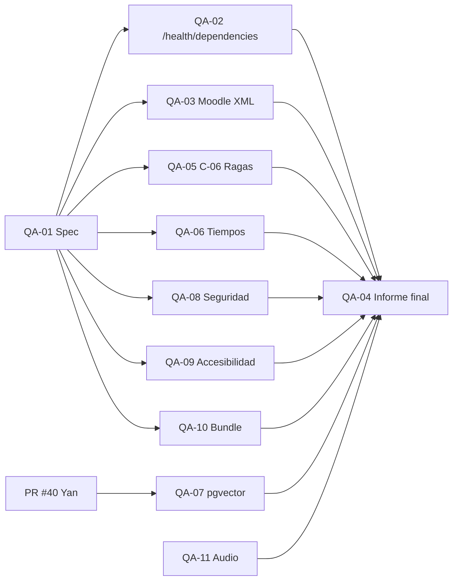

# Plan de atributos de calidad — Sprint 2

[Ficha QA](spec.md) · [Tareas](tasks.md)

**Rama** `docs/qa-01-quality-spec` (documentación) · **Fecha** 2026-11-14 · **Cierre** 2026-11-16 09:00

## Resumen

El Sprint 2 aborda los hallazgos del Sprint 1 en ocho atributos de calidad ISO 25010. Cada tarea produce un cambio acotado, con pruebas automáticas y evidencia medible. El enfoque es defensivo: medir primero, corregir después y registrar el resultado aunque no alcance la meta.

## Contexto técnico

| Campo | Valor |
| --- | --- |
| Backend | Python 3.12, FastAPI, SQLAlchemy 2, PostgreSQL (Neon, pgvector) o SQLite. Arquitectura hexagonal. |
| Frontend | React 18, TypeScript 5.6, Vite 5, Vitest 3, Playwright. |
| CI | GitHub Actions. Backend: cobertura ≥ 80 % de `domain` + `application`, e2e con SQLite y PostgreSQL, verificación OpenAPI. Frontend: lint, test, build, e2e. |
| Despliegue | Backend en Render, frontend en Vercel. |
| IA | `LLM_PROVIDER=rules` en CI y local. Gemini solo en Render con la clave de Yan. |

## Enfoque técnico por tarea

### QA-01 · Especificación de calidad

**Responsable:** Juan · **Tipo:** Documentación

Crear `specs/005-atributos-calidad/` con `spec.md`, `plan.md` y `tasks.md` siguiendo las plantillas y el estilo de los specs 001 y 002. Un escenario de calidad por tarea con las seis partes de ISO 25010. Sin cambios de código.

---

### QA-02 · Diagnóstico de dependencias (`GET /health/dependencies`)

**Responsable:** Juan · **Tipo:** Backend · **Atributo:** Fiabilidad

**Enfoque:** Puerto `DependencyProbePort` en `application/ports/outbound`, caso de uso que ejecuta las comprobaciones en paralelo con tiempo límite de 3 s, adaptadores en `infrastructure`:
- **Base de datos:** `SELECT 1`.
- **Gemini:** Consulta de metadatos del modelo (`GET` del modelo, 0 tokens). Si `LLM_PROVIDER=rules` o no hay clave: `not_configured`.
- **Wikipedia:** Consulta liviana a la misma API en español que usa la importación.

Respuesta siempre 200 (503 solo si la base de datos está caída). Caché de 30 s. Motivos genéricos con `public_reason` / `redact_secrets`.

**Validación de Yan y Sergio:** Yan confirma que la generación usa el generador por reglas cuando Gemini está caído, con su motivo. Sergio confirma que la importación desde Wikipedia muestra el error sin afectar la subida manual.

---

### QA-03 · Moodle XML con tres tipos y matriz TA-006

**Responsable:** Juan · **Tipo:** Backend + Frontend (si hace falta) · **Atributo:** Compatibilidad

**Enfoque:**
- `verdadero_falso` → `<question type="truefalse">`: una pregunta por afirmación, respuesta correcta en `fraction="100"`, retroalimentación con cita.
- `emparejamiento` → `<question type="matching">`: un `<subquestion>` por par (mínimo 3), `shuffleanswers` activo, retroalimentación general.
- Actualizar la elegibilidad de exportación para los tres tipos.
- Actualizar mensajes del frontend si mencionan que Moodle solo exporta opción múltiple.
- Importación real en Moodle 5.3.1, con capturas en `docs/evidence/QA-03/`.
- Matriz TA-006 en `docs/compatibility/TA-006-matriz.md`.

---

### QA-04 · Informe final de calidad

**Responsable:** Juan · **Tipo:** Documentación

**Enfoque:** Recopilar resultados de todas las tareas tras la integración. Tabla con ID, responsable, atributo, escenario, meta, resultado, ¿cumple? y evidencia. Conclusión por atributo. Lista de verificación para el despliegue.

**Dependencia:** Va al final, después de todos los PR del equipo.

---

### QA-05 · Rechazo sin material del tema (C-06)

**Responsable:** Yan · **Tipo:** Backend · **Atributo:** Adecuación funcional

**Enfoque:** C-06 pasa sin generar si no hay material del tema. C-01 a C-05 siguen generando con `faithfulness` ≥ 0,90. Evaluación con Ragas.

**Diseño.** Reemplaza T074 de `specs/002-generacion-multiple`. La comprobación va en el pedido de generación, justo después de recuperar la evidencia y antes de redactar, y no usa IA: funciona igual con `LLM_PROVIDER=rules`.

- **Tema pedido.** Son las indicaciones del docente. Sin indicaciones no hay nada que comprobar: el resultado de aprendizaje siempre es de la unidad. Tampoco se comprueba si las indicaciones dejan menos de 2 términos (por ejemplo, «Usa ejemplos breves» o «¿Cuáles son las características principales de UDP?»).
- **Términos del tema.** Palabras de las indicaciones en minúsculas y sin tildes, de 3 o más letras, o siglas de 2 en mayúsculas (IP). Se quitan las palabras vacías del español, las de estilo, pedagogía o tipo de recurso (breve, ejemplos, estudiantes, explica, actividad, pregunta, usa, glosario…) y las que solo formulan la pregunta (diferencia, características, principal, función, términos clave, conviene…).
- **Frases del tema.** Dos términos seguidos, o unidos por «de», «del», «de la»…: «protocolo de transporte», «llaves primarias», «modelo relacional».
- **Medida absoluta.** Cobertura: qué parte de los términos aparece en los fragmentos recuperados, con igualdad sin tildes y con el singular y el plural («capa» y «capas»). No se usa la relevancia de BM25 ni de la fusión híbrida, que se normaliza y siempre vale 1,0 en el primer fragmento. Tampoco se comparan raíces: «relacional» coincidiría con «relación», que aparece en textos de cualquier tema.
- **Decisión.** Se rechaza si la cobertura queda por debajo del umbral **y** no aparece ninguna frase del tema. Una frase presente basta, porque las palabras de un escenario no están en el material aunque el tema sí («una empresa que transmite en vivo» sobre «protocolo de transporte», c04). Y una palabra suelta puede coincidir con otro sentido: «tablas» de enrutamiento y «modelo» OSI en C-06.
- **Umbral.** `TOPIC_COVERAGE_THRESHOLD` (`infrastructure/settings.py`), 0,5 por defecto; 0 apaga la comprobación. En la medición, los casos que deben generar y no tienen ninguna frase presente (c02, c03, c05, c07 y C-05) tienen una cobertura de 0,60 como mínimo (c07), y C-06 tiene 0,40. El umbral de 0,5 queda entre los dos.
- **Secuencias.** Una secuencia comparte una sola recuperación y las mismas indicaciones, así que se decide una vez por pedido. Si no pasa, ningún paso redacta.
- **Al rechazar.** No se redacta ni se guarda ningún recurso. El pedido y sus pasos terminan `failed` con el código existente `INSUFFICIENT_EVIDENCE` y un motivo que nombra lo que falta, como lo escribió el docente: «El material de la unidad no trata «llaves primarias, modelo relacional». Sube material sobre ese tema o cambia las indicaciones.». La evidencia recuperada queda guardada (`GET /generation-requests/{id}/evidence`). La regeneración desde Revisión usa la misma ejecución, así que aplica la misma comprobación y responde 409 con ese motivo.
- **Código.** `domain/generation/topic_coverage.py` (términos, frases y cobertura) y `RunGenerationRequest` (decisión y motivo). Pruebas: `tests/unit/test_topic_coverage.py` y `tests/e2e/test_collect_samples.py`.

**Medición** (16/11/2026; sin IA, en un servidor local con SQLite, `LLM_PROVIDER=rules` y búsqueda `bm25_fallback`, `topK` 8). Casos de `backend/evaluation/cases_t067.json` con `corpus_t067` y de `backend/evaluation/cases.json` con `corpus/protocols.txt`, que tiene un solo fragmento de 155 palabras. Los fragmentos son los que guardó cada pedido. La misma corrida con la comprobación activa dio las mismas decisiones: 15 casos generan y C-06 se rechaza.

| Caso | Fragmentos | Términos del tema | Presentes | Cobertura | Frases del tema (presentes en negrita) | Decisión |
| --- | --- | --- | --- | --- | --- | --- |
| c01 | 1 | videollamadas, cortan, protocolo, confirma, entrega | 4 de 5 | 0,80 | **confirma la entrega** | Genera |
| c02 | 1 | tcp, udp | 2 de 2 | 1,00 | — | Genera |
| c03 | 1 | tcp, confirma, retransmite, segmentos, perdidos | 4 de 5 | 0,80 | tcp confirma, retransmite los segmentos, segmentos perdidos | Genera |
| c04 | 1 | empresa, protocolo, transporte, transmitir, vivo | 3 de 5 | 0,60 | **protocolo de transporte** | Genera |
| c05 | 1 | tcp, udp | 2 de 2 | 1,00 | — | Genera |
| c06 | 1 | protocolos, transporte, red | 2 de 3 | 0,67 | **protocolos de transporte** | Genera |
| c07 | 1 | protocolo, juego, linea, transferencia, archivos | 3 de 5 | 0,60 | transferencia de archivos | Genera |
| c08 | 1 | protocolo, garantiza, entrega, confiable, datos | 5 de 5 | 1,00 | protocolo garantiza, **entrega confiable**, **confiable de los datos** | Genera |
| c09 | 1 | dispositivo, decide, camino, paquete, destino | 5 de 5 | 1,00 | dispositivo decide, **decide el camino** | Genera |
| c10 | 1 | protocolo, ip, direccionamiento, enrutamiento | 4 de 4 | 1,00 | **protocolo ip** | Genera |
| C-01 | 8 | modelo, osi, capas | 3 de 3 | 1,00 | **modelo osi** | Genera |
| C-02 | 8 | udp | 1 de 1 | 1,00 | — | Genera (menos de 2 términos: no se comprueba) |
| C-03 | 8 | tcp, udp, capa, transporte | 4 de 4 | 1,00 | **capa de transporte** | Genera |
| C-04 | 8 | direccionamiento, ip, enrutamiento, red | 4 de 4 | 1,00 | **direccionamiento ip** | Genera |
| C-05 | 8 | wireshark, analisis, redes | 3 de 3 | 1,00 | análisis de redes | Genera |
| C-06 | 8 | tablas, llaves, primarias, modelo, relacional | 2 de 5 | 0,40 | llaves primarias, modelo relacional | Rechaza: «llaves primarias, modelo relacional» |

Los resultados medidos con Ragas se agregan en `tasks.md` después de la corrida real.

---

### QA-06 · Tiempos de respuesta y límite de Gemini

**Responsable:** Yan · **Tipo:** Backend · **Atributo:** Eficiencia de desempeño

**Enfoque:** Medir p95 del `POST` con 5 secuencias en paralelo. Configurar un tiempo límite de 60 s por llamada a Gemini para que ninguna quede colgada.

---

### QA-07 · Búsqueda híbrida con pgvector

**Responsable:** Sergio · **Tipo:** Backend · **Atributo:** Adecuación funcional

**Enfoque:** Medir `context_recall` con pgvector usando la evaluación Ragas. Verificar que los fragmentos del documento distractor no aparecen en C-01 a C-05.

**Dependencia:** PR #40 de Yan (corpus de T067 y resultados de Ragas de T068).

---

### QA-08 · Límite de intentos de sesión y cabeceras de seguridad

**Responsable:** Sergio · **Tipo:** Backend · **Atributo:** Seguridad

**Enfoque:** Límite de 5 intentos por correo e IP en 15 min; el 6.º responde 429 con `Retry-After`. Sin revelar si el correo existe. Middleware para cabeceras `X-Content-Type-Options: nosniff`, `Content-Security-Policy: frame-ancestors 'none'` y `Referrer-Policy`. `pip-audit` sin vulnerabilidades altas.

---

### QA-09 · Accesibilidad con axe en Playwright

**Responsable:** Silvana · **Tipo:** Frontend · **Atributo:** Usabilidad

**Enfoque:** Integrar `@axe-core/playwright` en las pruebas e2e. Verificar 0 violaciones serias o críticas de WCAG 2.1 AA. Recorrido completo solo con teclado.

---

### QA-10 · Presupuesto del bundle y auditoría npm

**Responsable:** Silvana · **Tipo:** Frontend · **Atributo:** Eficiencia y seguridad

**Enfoque:** Carga diferida (`React.lazy` y `Suspense`). Presupuesto de JavaScript inicial < 200 kB comprimido. La CI falla si se pasa del presupuesto o si `npm audit` encuentra vulnerabilidades altas.

---

### QA-11 (opcional) · Verificación frase por frase de guiones de audio

**Responsable:** Juan · **Tipo:** Backend · **Atributo:** Adecuación funcional

**Enfoque:** En `resource_verification.py`, verificar cada frase del guion de `audio_detonante` y `podcast_resumen` contra los fragmentos citados. Subir `VERIFICATION_RULE_VERSION`. Los audios aprobados antes del cambio se reverifican al leerlos (verificación heredada). Solo se hace si las tareas 1 a 4 están integradas.

## Dependencias entre tareas

- **QA-01** es el punto de partida: define los escenarios y las tareas.
- **QA-02** la validan Yan y Sergio (comportamiento con dependencia caída).
- **QA-07** depende del PR #40 de Yan (corpus de T067 y resultados de Ragas de T068).
- **QA-04** va al final, después de todos los PR del equipo.
- **QA-11** es opcional y solo se hace si las tareas 1 a 4 están integradas.
- Las demás tareas son independientes entre sí y pueden hacerse en paralelo.
